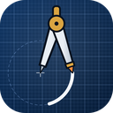

<p align="center">
  <a href="https://draftcraft.dev/">
    <picture>
      <source media="(prefers-color-scheme: dark)" srcset="assets/brand/dev-logo-dark.svg">
      
    </picture>
  </a>
</p>

<h1 align="center">D.E.V. Launcher</h1>

<p align="center">
  <b>The best drafting and graphic design software, for everyone.</b><br>
  One place to install, update and open DraftCraft and the DraftCraft community apps,<br>
  on Windows, macOS and Linux. Open source and written in pure Rust.
</p>

<p align="center">
  <a href="https://discord.gg/YgRK8Eww9x"></a>
</p>

<p align="center">
  <a href="https://draftcraft.dev/">draftcraft.dev</a> ·
  <a href="https://github.com/DraftCraft-DEV">DraftCraft Engineering Ventures on GitHub</a> ·
  <a href="https://discord.gg/YgRK8Eww9x">Discord</a>
</p>

> **Our mission is to bring the best drafting and graphic design software to everyone.**
> The DraftCraft community is people who draw, design and build: drafters, engineers, illustrators,
> makers and the curious. If you make things, you're one of us.
> **[Come say hi on Discord](https://discord.gg/YgRK8Eww9x).**

## The apps

| App | What it is | From |
|---|---|---|
|  **[DraftCraft](https://github.com/DraftCraft-DEV/DraftCraft)** | 2D CAD and drafting: a Windows-style ribbon, AutoCAD's command names, and DWG and DXF read and written by its own code. | DraftCraft Engineering Ventures |
|  **[TraceDraw](https://github.com/tracedraw/tracedraw)** | Vector illustration, page layout and print. A community app, installed from its makers' official releases, unaltered. | The TraceDraw contributors |

Each app downloads only from its own repository's releases, and every file is checked against the
release's SHA-256 checksums before anything is opened or installed.

## What it does

- **Install and update:** the right build for your computer, kept up to date from each app's
  releases.
- **Open:** any app from one window, or from the tray and menu-bar icon.
- **Native:** egui, no Electron and no web view; the same Rust also runs in the browser.

## Status

D.E.V. Launcher is in development and not released yet. Where the work stands and what comes next
are in [handoff.md](handoff.md) and [docs/dev-launcher-plan.md](docs/dev-launcher-plan.md).

## Build

```sh
cargo run -p dev-launcher        # the desktop app
cargo xtask ci                   # fmt, clippy, tests and the wasm check
```

## Credits

D.E.V. Launcher is built from [ArtCraft Launcher](https://github.com/storytold/craft-launcher) by the
ArtCraft Team and its contributors (MIT OR Apache-2.0), whose history this repository keeps. Thank
you to everyone who built it.

## License

Dual-licensed under the [MIT License](LICENSE-MIT) or the [Apache License 2.0](LICENSE-APACHE), at
your option. Copyright (c) 2026 the ArtCraft Team and the ArtCraft Launcher contributors, and
DraftCraft Engineering Ventures and the D.E.V. Launcher contributors. Required notices are in
[NOTICE](NOTICE).

The app icons in `assets/app-icons/` are each app's own icon, copied unmodified from its repository.
**The D.E.V. name, logos and marks (`assets/brand/`) and the DraftCraft name and icon are trademarks
of DraftCraft Engineering Ventures** and are not covered by the code licence.

<p align="center">
  <sub>Made by DraftCraft Engineering Ventures and the DraftCraft community.</sub>
</p>
